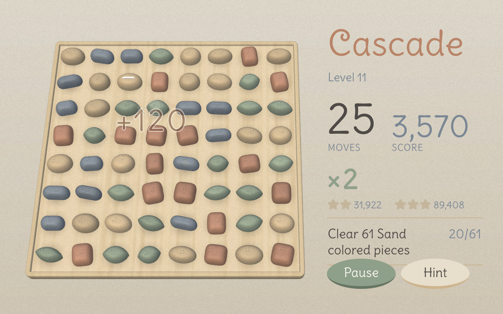
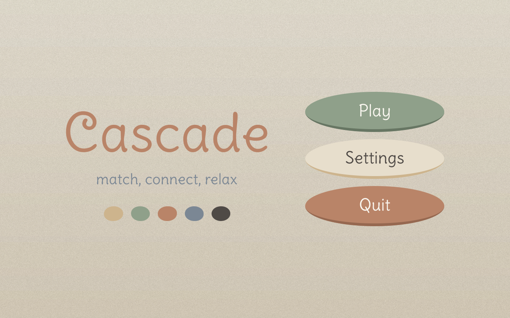
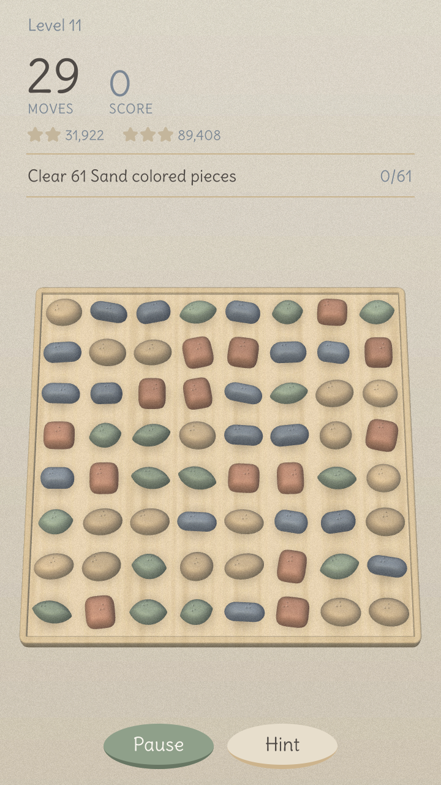

# Cascade

<p align="center">
  
</p>

**A calm match-3 puzzle game for Windows and Android, with levels generated on the fly from a tunable difficulty curve instead of being authored or pre-generated in advance.**

| | |
|---|---|
| **100% local** | Runs entirely on your device. No servers, no accounts, no sign-in, no internet needed. The game code contains no networking. |
| **No ads** | None. No ad SDK is in the project. |
| **No costs** | No purchases, no premium tier, no coins or gems, no timers that make you wait. No in-app purchase SDK is in the project. |
| **No tracking** | No analytics, no telemetry. Your progress is a small save file on your own device. |

<p align="center">
  
  
</p>

Development APKs (the only kind built so far) carry Android's `INTERNET` permission, which Unity adds to
development builds for its profiler. The game does not use it, and the project leaves Unity's
"force internet permission" setting off.

## Make it better

This is a hobby project and it is far from finished. Ideas that would help most:

- **Test on real devices.** The Galaxy S23 checks are still open: the 120 fps target and the Vulkan
  path (see [Status](#status)), plus the rest of the [TRD 13.11](docs/TRD.md) Android checklist.
- **Try the difficulty dials.** Levels come from a tunable curve, so feedback on how a level feels
  (too easy, too hard, too long) is the most useful thing a player can send.
- **Art and layout.** The [candidate looks](docs/art/README.md) (I, J, K) are all in the project.
  Small layout glitches on odd window sizes are welcome fixes.
- Before changing generation or rules code, run the logic tests (`dotnet test tools/Cascade.Tests.Headless`).

The project has no license file yet, so until one is added the usual default applies: all rights reserved.

## Status

The game is built on **Unity 6 and C#**, with Android as a first-class target
([ADR-006](docs/adr/ADR-006-unity-engine.md)). The milestones are in [TRD §10](docs/TRD.md)
(U0-U9). [conformance/](conformance/README.md) holds the reference fixtures the C# code is checked
against. **U0 and U1 are done** on the emulator (the S23 checks are pending); the logic layers (U2, U3) are built and tested; **U4 (playable in Unity, mouse, Editor and Windows build), U5 (dials page and game shell) and U6 (K: Pebbles art pass, [style doc](docs/art/STYLE-K-Pebbles.md)) are done**; **U7 (Android) is partly signed off**: touch, rotation and portrait/landscape work on the S23; the rest of the [TRD 13.11](docs/TRD.md) checklist is open. Still to check on the Galaxy S23 itself: the 120 fps target (TRD 13.9: build a dev APK and run it with `-showfps`) and the Vulkan path.

## Unity build

```powershell
dotnet test tools/Cascade.Tests.Headless          # logic tests, no Unity needed
& "$env:ProgramFiles\Unity\Hub\Editor\6000.6.4f1\Editor\Unity.exe" -batchmode -nographics -quit `
  -projectPath unity -buildTarget Android -executeMethod Cascade.Editor.BuildScript.BuildAndroid -dev -logFile Builds/build.log
# Windows player: ... -buildTarget StandaloneWindows64 -executeMethod Cascade.Editor.BuildScript.BuildWindows  (Builds/Windows/cascade.exe;
#   `cascade.exe -level 40 -seed 7` starts at level 40; `-autoplay 10` plays 10 hint moves, checks the view and quits; `-screen title|map|settings|dev` opens a page; `-datadir PATH` chooses the save folder, `-level`/`-autoplay` runs use a scratch folder; `-shot PATH` saves a screenshot of the window and quits; `-showfps` shows a frame-rate readout in dev builds)
# PlayMode tests (real mouse events, screenshots in Builds/shots): Unity -batchmode -projectPath unity -runTests -testPlatform PlayMode -testResults Builds/playmode.xml
# APK: Builds/Android/cascade-<version>-<hash>-dev.apk (sideload with adb install -r)
# WebGL (a browser playtest build, TRD 13.12): ... -buildTarget WebGL -executeMethod Cascade.Editor.BuildScript.BuildWebGL [-dev]  (Builds/WebGL/dev or /release)
dotnet run --project tools/Cascade.Tools -- serve                  # serve Builds/WebGL/dev on the LAN (http://<this PC>:28420/); the URLs are printed
```

In VS Code, the "WebGL: ..." launch configs (`.vscode/webgl.ps1`) build and serve in one step; open the printed LAN address on a phone on the same network.

See [TRD §14](docs/TRD.md) for the dev environment, the command-line builds and the repo layout.
Build output goes to `Builds/`, which is ignored by the repo.

## Design docs

- [MRD](docs/MRD.md): market requirements
- [PRD](docs/PRD.md): product requirements
- [TRD](docs/TRD.md): technical requirements
- [Art styles](docs/art/README.md): candidate 3D looks I, J, K
- [ADRs](docs/adr/README.md): architecture decision records
