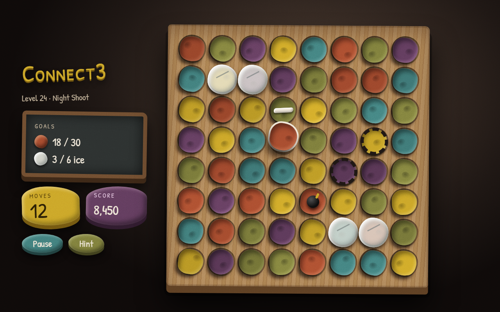
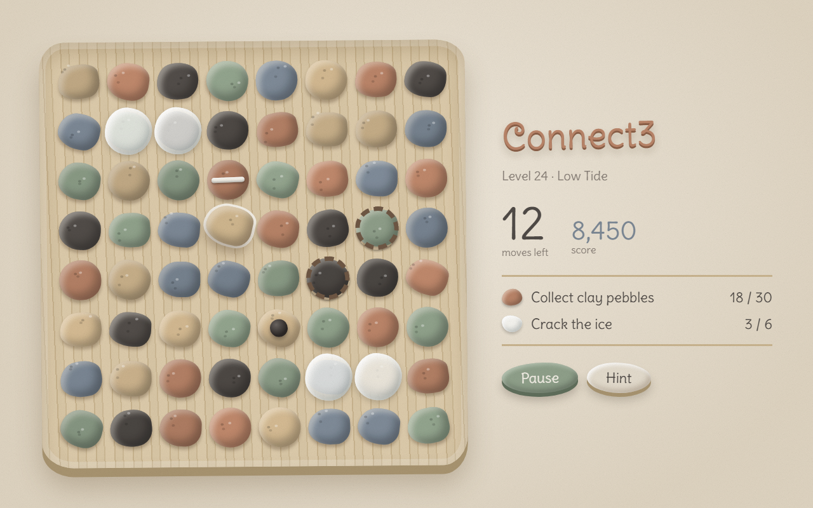

# Cascade Art Style Candidates

**v1 implements K: Pebbles** (PRD §5.4). I and J stay documented as alternatives.

These are three candidate directions for the 3D claymation look described in
[PRD §2.8](../PRD.md). I ("Claymation") is the parent direction; J and K are variations on it.
All three share these rules:

- real 3D pieces
- natural earth-pigment colors
- a distinct silhouette for each color
- small seeded variation on every piece

| Doc | In one line | What it pushes |
|---|---|---|
| [I: Claymation](STYLE-I-Claymation.md) | Rough plasticine on a kraft-paper potter's shelf | Handmade wobble and squash-and-stretch |
| [J: Studio Set](STYLE-J-StudioSet.md) | A stop-motion film still on a dark set | Lighting and mood |
| [K: Pebbles](STYLE-K-Pebbles.md) | Clay pebbles on driftwood in calm daylight | Piece form and a quiet palette |

All three follow the same plan of one mesh set per color. That makes a style a preset of
material, lighting and HUD in the view layer ([TRD §12](../TRD.md)). Switching styles, or mixing
them per world (for example K for calm early levels and J for later ones), must not touch game
logic.

## At a glance

| I: Claymation | J: Studio Set | K: Pebbles |
|---|---|---|
|  |  |  |

## Files

- `img/`: rendered mockup PNGs and palette swatches (SVG), embedded in the style docs.
- `mockups/`: standalone HTML sources for each mockup. Open one in a browser to view it; fonts
  load from Google Fonts. To re-render a PNG, use headless Chrome:
  `chrome --headless=new --window-size=1280,800 --virtual-time-budget=8000 --screenshot=img/X.png mockups/X.html`

The original mockups are also on the [look explorations canvas](https://claude.ai/artifact/41j1bK2HhRddKzm6iBbznU).
