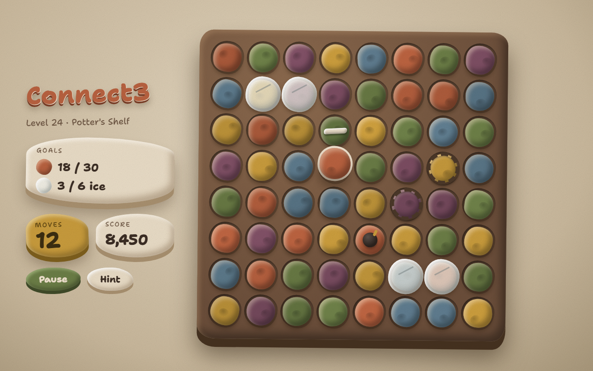
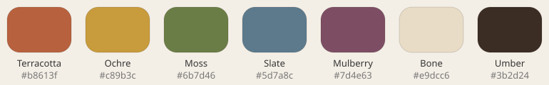

# Cascade Art Style I: Claymation

| | |
|---|---|
| Status | Candidate style, Draft v0.1 |
| Date | 2026-10-03 |
| Mockup | [img/I-Claymation.png](img/I-Claymation.png) (source: [mockups/I-Claymation.html](mockups/I-Claymation.html); [online canvas](https://claude.ai/artifact/41j1bK2HhRddKzm6iBbznU)) |
| Related | [PRD §2.8](../PRD.md) · [TRD §12](../TRD.md) · [J: Studio Set](STYLE-J-StudioSet.md) · [K: Pebbles](STYLE-K-Pebbles.md) · [Style index](README.md) |

*Gameplay mockup (2D stand-in for the 3D look): 8×8 board with a selected piece, Line tile, Bomb, ice and chains.*

## 1. Concept
Rough, hand-squeezed plasticine on a potter's shelf, in warm daylight. Every piece looks pressed
by a thumb, a little lopsided and never perfect. This is the parent direction: J and K are
variations on it. It sits in the middle on mood: warmer and lighter than J, and more colorful and
lively than K.

**Keywords:** claymation, plasticine, thumbprints, earth pigments, kraft paper, handmade.

## 2. Palette

Natural earth pigments, not bright or pastel colors. Each piece color has a body tone and a
shadow tone.

| Role | Color | Body | Shadow |
|---|---|---|---|
| Piece 0 | Terracotta | `#b8613f` | `#7a3d26` |
| Piece 1 | Ochre | `#c89b3c` | `#7d5e1c` |
| Piece 2 | Moss | `#6b7d46` | `#3f4a28` |
| Piece 3 | Slate | `#5d7a8c` | `#354a56` |
| Piece 4 | Mulberry | `#7d4e63` | `#4a2c3b` |
| Piece 5 (6-color levels) | Bone | `#e9dcc6` | `#a8906f` |
| Piece 6 (7-color levels) | Umber | `#3b2d24` | `#1e1611` |

| Role | Color |
|---|---|
| Background | Kraft paper, `#e3d6bf` → `#c9b89c` → `#a8977a` |
| Board tray | Brown clay slab, `#8c6a4e` → `#6b4e3a`, base `#45311f` |
| HUD cards | Bone clay, `#e9dcc6` |
| Text | Umber, `#3b2d24` |
| Accent / title | Terracotta, `#b8613f` |

## 3. Pieces (3D)
- **Material:** soft plasticine. Matte (roughness ~0.9) with a visible thumbprint and tool-mark
  normal map, slight wrap lighting, and no specular highlight.
- **Shape:** puffy, irregular blobs about 0.85 of a cell wide. Each color has its own silhouette:

  | Color | Silhouette |
  |---|---|
  | Terracotta | Squat rounded cube |
  | Ochre | Dome |
  | Moss | Triangular lump |
  | Slate | Flat puck |
  | Mulberry | Teardrop |
  | Bone | Star lump |
  | Umber | Diamond |

- **Variation:** the most wobble of the three styles. Each piece gets yaw ±7°, blob radius
  ±10%, brightness ±7%, and one thumbprint dent at a random spot. There are 3–4 sculpt variants
  per color. Wobble amount is a tunable setting.
- **Selected:** the piece lifts 0.15 cell, scales to 1.08 and gets a bone-white ring.

## 4. Lighting and camera
- A soft warm key light from the upper left plus a gentle fill. Shadows are soft and short.
- Camera: three-quarter view, about 30° from vertical.
- A paper grain overlay (multiply, about 22%) covers the whole frame.

## 5. Board, blockers and specials

| Element | Look |
|---|---|
| Tray | Hand-pressed brown clay slab with uneven edges and a thick base |
| Cells | Shallow, irregular thumb-pressed hollows |
| Ice | Frosted translucent clay slab with a crack line per layer |
| Stone | Grey clay brick with chipped edges |
| Chains | Dark clay rope coiled around the piece |
| Line tile | Bone clay stripe pressed across the piece |
| Bomb | Dark clay ball with an ochre fuse |
| Color tile | Marbled swirl of all active colors |

## 6. HUD and typography
- **Font:** Shantell Sans (weights 500 and 800), a handwritten style.
- **Cards:** goals, moves and score sit on lumpy bone or ochre clay slabs, each slightly rotated
  so they look hand-placed.
- **Buttons:** clay lozenges (moss Pause, bone Hint) with a pressed-depth shadow.

## 7. Animation
The most squash-and-stretch of the three styles.

| Event | Animation |
|---|---|
| Swap | Pieces squish past each other and bulge on arrival |
| Fall / move | Stretch while falling, splat 25% on landing, two settle wobbles |
| Clear | Squashed flat by an unseen thumb, then crumbles into clay crumbs |
| Specials | Pieces along the line or blast area pop in a quick ripple |
| Layer change (2½D boards) | The camera tilts, with a slight hand-held wobble |
| Idle | Occasional tiny breathing wobble, like boiling-line animation |

## 8. Strengths and risks

| Strengths | Risks |
|---|---|
| Truest to "claymation"; the most character and charm | Heavy wobble can blur silhouettes on small screens; keep it tunable |
| Warm and light; works for many level themes | The middle option, less striking than J and less calm than K |
| Cheap lighting (soft shadows) | Terracotta, ochre and mulberry need silhouettes for color-blind players |
