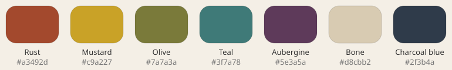

# Cascade Art Style J: Studio Set

| | |
|---|---|
| Status | Candidate style, Draft v0.1 |
| Date | 2026-10-03 |
| Mockup | [img/J-StudioSet.png](img/J-StudioSet.png) (source: [mockups/J-StudioSet.html](mockups/J-StudioSet.html); [online canvas](https://claude.ai/artifact/41j1bK2HhRddKzm6iBbznU)) |
| Related | [PRD §2.8](../PRD.md) · [TRD §12](../TRD.md) · [K: Pebbles](STYLE-K-Pebbles.md) · [I: Claymation](STYLE-I-Claymation.md) · [Style index](README.md) |

*Gameplay mockup (2D stand-in for the 3D look): 8×8 board with a selected piece, Line tile, Bomb, ice and chains.*

## 1. Concept
A still from a stop-motion film shot at night. The board is a prop on a dark set under one hard
key light. The mood is focused and theatrical: the lit board is the only bright thing on screen.

**Keywords:** stop-motion set, hard light, long shadows, plasticine, handmade props.

## 2. Palette

| Role | Color | Hex | Rim-light tint |
|---|---|---|---|
| Piece 0 | Rust | `#a3492d` | `#e08a66` |
| Piece 1 | Mustard | `#c9a227` | `#f2d978` |
| Piece 2 | Olive | `#7a7a3a` | `#b9b96e` |
| Piece 3 | Teal | `#3f7a78` | `#8fc4c0` |
| Piece 4 | Aubergine | `#5e3a5a` | `#b082aa` |
| Piece 5 (6-color levels) | Bone | `#d8cbb2` | `#fff4dc` |
| Piece 6 (7-color levels) | Charcoal blue | `#2f3b4a` | `#7a8ea6` |
| Backdrop | Warm black falloff | `#4a3a30` → `#0e0a09` | |
| Board tray | Plywood planks | `#a87d4f` / `#9c7146` | |
| Text | Warm paper | `#efe6d6` | |
| Accent / title | Mustard | `#c9a227` | |

## 3. Pieces (3D)
- **Material:** raw plasticine. Matte (roughness ~0.85) with a fine fingerprint and tool-mark
  normal map. Slight wrap lighting keeps the shadow sides from going black.
- **Shape:** rounded blobs about 0.85 cell wide. Each color has its own silhouette:

  | Color | Silhouette |
  |---|---|
  | Rust | Squat cube |
  | Mustard | Dome |
  | Olive | Triangular prism |
  | Teal | Cylinder puck |
  | Aubergine | Teardrop |
  | Bone | Star lump |
  | Charcoal blue | Diamond |

- **Variation:** each piece is seeded from its tile id: yaw ±8°, scale ±6% per axis,
  brightness ±9%, and one thumbprint decal. There are 3–4 sculpt variants per color.
- **Selected:** the piece lifts 0.15 cell, scales to 1.08 and gets a paper-white outline ring.

## 4. Lighting and camera
- One hard directional key light from the upper right, about 40° above the board. Shadow maps
  are crisp: each shadow is about one piece tall and falls down-left.
- A colored rim light sits behind each piece (tints above), plus a very low warm fill.
- A spotlight cone falls on the board, with darkness outside it (vignette).
- Camera: three-quarter view, about 35° from vertical.
- Film grain overlay at about 35%. An optional 12 fps "on twos" animation mode gives the
  stop-motion feel.

## 5. Board, blockers and specials

| Element | Look |
|---|---|
| Tray | Plywood plank board with a thick bevel and a deep drop shadow into the black set |
| Cells | Shallow pressed-in dimples, darker than the tray |
| Ice | Frosted translucent clay slab (alpha ~0.75), with one crack line per layer |
| Stone | Grey unfired clay brick with chipped edges |
| Chains | Dark clay rope coil wrapped around the piece |
| Line tile | Bone-white clay stripe pressed across the piece |
| Bomb | Black clay ball with a mustard fuse |
| Color tile | Marbled swirl of all active colors |

## 6. HUD and typography
- **Fonts:** Patrick Hand SC for the title, Patrick Hand for body text.
- **Goals card:** a chalkboard in a wooden frame, with goals written in chalk.
- **Moves and score:** chunky clay plaques (mustard for moves, aubergine for score), slightly
  rotated.
- **Buttons:** clay lozenges (teal Pause, olive Hint) with a pressed-depth shadow.

## 7. Animation

| Event | Animation |
|---|---|
| Swap | Pieces arc over each other and squash slightly on landing |
| Fall / move | Accelerate along the path, squash 20% on impact, one settle wobble |
| Clear | Flattens as if pressed by a thumb, then pops off with a smear frame |
| Specials | The key light flickers and a dust puff catches the light |
| Layer change (2½D boards) | The camera dollies as if on a rail; the key light stays fixed |

## 8. Strengths and risks

| Strengths | Risks |
|---|---|
| Strongest mood and brand identity | The dark backdrop makes lighter level themes hard |
| Hard shadows make depth clear on 2½D boards | Shadow maps cost more than the other styles |
| The stop-motion frame-rate mode is a cheap, distinctive touch | Rust/mustard and olive/teal can be confused by color-blind players, so silhouettes must stay distinct |
