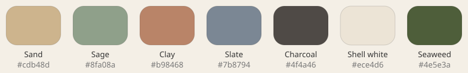

# Cascade Art Style K: Pebbles

| | |
|---|---|
| Status | **Implemented** in Unity (U6, 2026-10-05); the S23 frame-rate check is still open |
| Date | 2026-10-03 (as-built notes 2026-10-05) |
| Mockup | [img/K-Pebbles.png](img/K-Pebbles.png) (source: [mockups/K-Pebbles.html](mockups/K-Pebbles.html); [online canvas](https://claude.ai/artifact/41j1bK2HhRddKzm6iBbznU)) |
| Related | [PRD §2.8](../PRD.md) · [TRD §12](../TRD.md) · [I: Claymation](STYLE-I-Claymation.md) · [J: Studio Set](STYLE-J-StudioSet.md) · [Style index](README.md) |

*Gameplay mockup (2D stand-in for the 3D look): 8×8 board with a selected piece, Line tile, Bomb, ice and chains.*

## 1. Concept
Handmade clay pebbles on a driftwood tray at the beach. This is the calmest of the three styles:
the surroundings are low-contrast and the pieces carry the screen.

**Keywords:** beach stones, driftwood, soft daylight, minimal, calm.

## 2. Palette

The colors are muted, so **lightness steps** do most of the work of telling pieces apart.
Distinct silhouettes are therefore required, not optional.

| Role | Color | Hex | Lightness (L*) |
|---|---|---|---|
| Piece 0 | Sand | `#cdb48d` | ~74 |
| Piece 1 | Sage | `#8fa08a` | ~64 |
| Piece 2 | Clay | `#b98468` | ~60 |
| Piece 3 | Slate | `#7b8794` | ~56 |
| Piece 4 | Charcoal | `#4f4a46` | ~32 |
| Piece 5 (6-color levels) | Shell white | `#ece4d6` | ~91 |
| Piece 6 (7-color levels) | Seaweed | `#4e5e3a` | ~38 |
| Background | Pale sand | `#efe8db` → `#dfd4c1` | |
| Board tray | Driftwood | `#d9c7a6` / `#c9b48f` grain | |
| Text | Charcoal | `#4f4a46` | |
| Accent / title | Clay | `#b98468` | |

## 3. Pieces (3D)
- **Material:** smooth, slightly worn clay (roughness ~0.7) with a soft fleck texture (2–3 flecks
  per piece) and a faint sheen on the top face.
- **Shape:** flatter, elongated pebbles, about 0.45 as tall as they are wide. Each color has its
  own silhouette:

  | Color | Silhouette |
  |---|---|
  | Sand | Oval |
  | Sage | Leaf |
  | Clay | Rounded square |
  | Slate | Long capsule |
  | Charcoal | Round disc |
  | Shell white | Scallop |
  | Seaweed | Kidney |

- **Variation:** yaw ±13°, squash 0.82–0.98 on one axis, brightness ±6%, and fleck positions.
- **Selected:** the piece lifts 0.15 cell, scales to 1.10 and gets a white halo ring.

## 4. Lighting and camera
- Soft overcast daylight: a large sky light from above, with soft contact shadows only.
- A low-intensity warm sun from the upper left adds a gentle highlight.
- Camera: three-quarter view, about 25° from vertical (flatter than J).
- Grain overlay at about 16%.

## 5. Board, blockers and specials

| Element | Look |
|---|---|
| Tray | Pale driftwood board with wood grain and an inset lip. Pieces sit loose, with **no sockets** |
| Ice | Frosted sea-glass shell over the pebble |
| Stone | A real-looking grey beach rock, rougher than the pebbles |
| Chains | Knotted loop of brown twine |
| Line tile | White quartz vein across the pebble |
| Bomb | Dark pebble with a hole worn through it (a "hag stone") |
| Color tile | Banded agate pebble showing all active colors |

## 6. HUD and typography
- **Fonts:** Delius Swash Caps for the title, Delius for body text.
- **Layout:** minimal. Moves and score are plain large numbers on the background, with no
  cards. The goals list sits between two thin driftwood lines.
- **Buttons:** pebble-shaped (sage Pause, sand Hint).

## 7. Animation

| Event | Animation |
|---|---|
| Swap | Pieces slide and rock slightly, like nudged stones |
| Fall / move | Short drop with a soft clack, a small bounce and a settling spin |
| Clear | The pebble sinks into sand and a ripple spreads out |
| Specials | A wave washes across the line or blast area |
| Layer change | Slow, gentle camera drift |

## 8. Strengths and risks

| Strengths | Risks |
|---|---|
| Calm and timeless; easy on the eyes in long sessions | The muted palette is at its limit with 5 colors; 6–7 colors depend on silhouettes |
| Cheapest lighting (no hard shadows) | Less "pop" in screenshots and store art |
| Loose, socket-free pieces suit non-grid layouts and funnels | May feel too quiet for exciting cascades |

## 9. Unity implementation notes
- **Shadows:** soft contact shadows are a blob quad per piece (radial alpha, 0.55, 1.05 cell); the
  halo, ripple and arrow are unlit translucent meshes. No shadow maps.
- **Light rig:** the clay and tray shaders read the style's `ambient`, `sky`, `sun` and sun
  heading/pitch as shader globals and do their math in display (gamma) space, so the look matches
  in a Gamma or Linear project. Colors in the palette are the unlit albedo; a top face
  under this rig comes out at about the palette color.
- **Variation:** fleck shifts are quantised (`fleck_quantum`) and brightness too, so pieces share
  materials; the pose (select lift, squash, roll, sink) is applied by `PieceView.ApplyPose`.
- **Camera:** `camera.fov_deg` 24 keeps the tray keystone mild at the 25 degree pitch.
- **Tuned on screenshots:** the lobes of the Shell scallop are kept gentle (6.5%) and the Kidney dent
  deep (0.17) so that all seven silhouettes stay distinct at 64 px per piece.
- **Slot clip:** the board shaders draw only inside the layout's `BoardSlot` (`camera.clipToSlot`, a
  style flag; `BoardCameraRig` publishes the slot as the globals `_CascadeClip` and `_CascadeClipVP`), so
  a zoomed or panned board never runs under the HUD text and a piece dropping in from above the tray
  is cut at the slot edge instead of covering the goals.

## 10. As built (U6)
Checked against the running game (Unity 6000.6, URP 17.6) by `Tests.Play/ArtAudit` (numbers and
sequences, screenshots in `Builds/shots/art`) and on a Windows build and the Android emulator.
- **Palette, silhouettes, camera, grain:** exactly as in sections 2 to 4 (the test compares the style
  asset with the hex values above). The grain is `Cascade/Grain` at `material.grain_alpha` 0.16, present in
  the Windows player and on the emulator.
- **Variation:** driven by the `[pieces]` dials (`variation_yaw_deg`, `variation_squash_min`,
  `variation_brightness`); squash is `squash_min..1.0` on one axis (the doc's "0.82 to 0.98" is the
  same range the view uses). Fleck strength is `material.fleck_dark` 0.42 / `fleck_light` 0.60 (raised
  from 0.32 / 0.50: at phone size the flecks were invisible).
- **Selection halo:** a white band with a soft warm-sand outer edge (so it shows on pale driftwood).
- **Holes:** the floor seen through an enclosed hole is `tray.hole_floor` `#8c7a5f` (was near black, which
  dominated 6 and 7 color boards); the Bomb's hole disc keeps `palette.hole`.
- **Agate:** one band per active color (7-color levels show Shell and Seaweed too).
- **Specials:** the line wash is a soft-edged strip (`fx.wash_color`, mesh `Wash`); ripples have a pale
  crest and a darker sand trough so they read on the tray.
- **Landing and shuffle squash** widen a pebble by `material.squash_spread` (0.5) of the volume-preserving
  amount, so a shuffle no longer makes neighbours overlap.
- **Score popups:** bold Delius Swash Caps, `rgb(122, 84, 62)` with a cream outline (white text was unreadable
  on the tray).
- **Shaders:** all five are SRP Batcher compatible (every property in `UnityPerMaterial`, checked by
  `Cascade/Check Shaders`); `Clay` had `_UseBands` outside the buffer.

